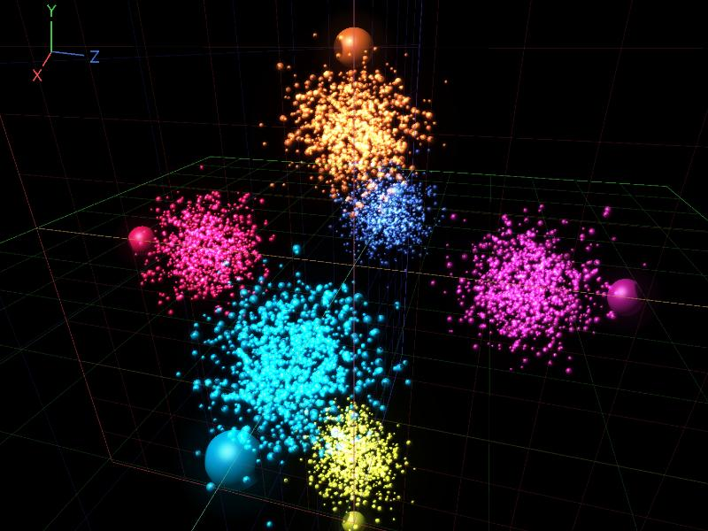
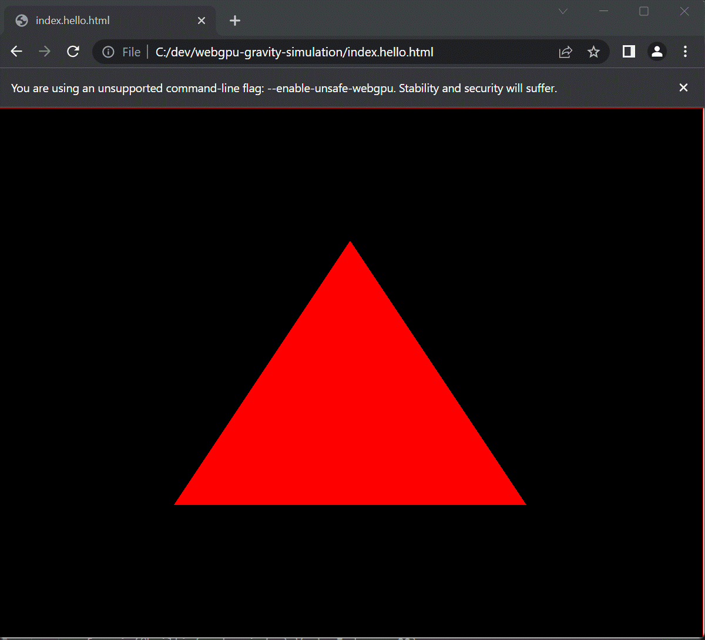

# WebGPU N-Body Gravity Simulation

**A real-time 3D N-body gravity simulation with particle collisions, running entirely on the GPU using WebGPU compute shaders (WGSL) in the browser.** No build step, no dependencies: plain JavaScript and HTML.

[](index.html)

<p align="center">
  <a href="https://www.w3.org/TR/webgpu/" title="WebGPU"></a>
</p>

## Features

- **GPU-accelerated N-body physics**: every particle is attracted by every other particle (all-pairs gravity), computed in WebGPU compute shaders. Optionally the pull is symmetric (momentum and angular momentum are kept).
- **Full collision physics** (a port of `compute_nbody_collisions` from native_ts_graphics): particles are solid spheres with spin. Bounciness that falls with impact speed, Coulomb friction, rolling resistance, contact springs, swept contacts for fast particles.
- **Heat**: the kinetic energy a contact loses becomes heat; particles glow and cool off over a few seconds.
- **Merging and breaking**: slow, hot particles merge (mass, volume, momentum and angular momentum kept, merged spheres grow back to their size); hard hits break a particle in two, into free slots.
- **Heavy attractors with particle clouds**: up to 24 massive centers, each with its own cloud, laid out as a preset, ring, sphere, line or random ball; clouds as a Gaussian, uniform ball, shell or flat disk.
- **HDR rendering**: lit spheres with spin marks, velocity trails, coordinate planes, an axis gizmo and a multi-level bloom, composited with a soft tone shoulder.
- **Control panel**: every switch and slider of the original (see below), all live; restart with new settings.
- **Interactive camera**: drag to rotate, wheel to zoom; it orbits by itself when left alone.
- **Multi-pass compute pipeline** over one in-place storage buffer: `calculate_cs` → `count_cs` → `collide_cs` → (`absorb_cs` → `kill_cs`) → (`collect_free_cs`) → `integrate_cs` → (`fragment_cs`).
- **Extra demos**: the previous, simpler collisions demo, Conway's Game of Life on the GPU and a minimal WebGPU "hello triangle".

## Demos

| File | What it is |
| --- | --- |
| [`index.html`](index.html) | N-body gravity simulation with collisions, heat, merging and breaking, with a control panel (main demo) |
| [`index.basic.html`](index.basic.html) | The earlier, simpler collisions demo (bounce, flash) |
| [`index.life.html`](index.life.html) | Conway's Game of Life as a compute shader |
| [`index.hello.html`](index.hello.html) | Minimal WebGPU example: a red triangle |

## Requirements

- A browser with [WebGPU](https://caniuse.com/webgpu) support, such as a recent Chrome or Edge (113+), or Firefox / Safari versions that ship WebGPU.
- A GPU and drivers that support WebGPU.

## Quick start

1. Clone the repository:

   ```bash
   git clone https://github.com/ASDAlexander77/webgpu-gravity-simulation.git
   cd webgpu-gravity-simulation
   ```

2. Open `index.html` in a WebGPU-enabled browser.

   Opening the file directly works, but if your browser blocks WebGPU on `file://` pages, serve the folder over `localhost` instead:

   ```bash
   npx serve .
   # or
   python -m http.server 8000
   ```

   On Windows you can also launch Chrome with WebGPU enabled using the bundled script, [`webgpu.bat`](webgpu.bat):

   ```cmd
   "%ProgramFiles%\Google\Chrome\Application\chrome.exe" --enable-unsafe-webgpu file:///path/to/index.html
   ```

Controls:

| Input | Action |
| --- | --- |
| Left mouse drag | Rotate the camera |
| Mouse wheel | Zoom in / out |
| Space | Pause / resume |
| C / H | Collisions / heating on and off |
| P / T | Coordinate planes / trails on and off |

The panel in the top right corner has four sections:

- **Simulation**: Paused, Collisions, Heating, Gravity between all pairs, Contact springs, Friction (μ), Rolling resistance (μr), Hard hits bounce less, Gravity softened by size, Merging (merge speed, hot particles stick), Breaking (break speed), and sliders for time scale, gravity G, bounciness, heat per energy and cooling time. A slider under a switch applies while the switch is on.
- **Display**: planes, axis gizmo, orbit when idle, lit spheres, spin marks, trails (length), bloom (strength, threshold).
- **Units**: what the sliders' units mean.
- **New simulation**: attractors (1–24), particles each, attractor and particle layouts, layout and attractor radius, particle radius range, cloud spread, fragment room, random seed, and **Restart**. These take effect on Restart.

Query parameters (as the example's command line): `?attractors=2&particles=1&merge=2&fragment=10&room=20&seed=7&fullgravity&nocool&noui`.

## How it works

The simulation keeps all particle state (position and mass, velocity, collision radius and heat, spin, spin marker and true radius: five `vec4`s each) in GPU storage buffers and reads it back only to count the particles left after merges. Each frame runs the compute passes in one compute pass over the same buffers, then renders:

1. **`calculate_cs`**: sums the gravitational pull of the other particles (through workgroup shared memory) and updates velocities.
2. **`count_cs`**: counts the contacts each particle has this step, weighted by how much each moves it.
3. **`collide_cs`**: resolves sphere–sphere contacts (bounce, friction, rolling, contact springs, heat), swept for fast pairs, and decides merges and breaks.
4. **`absorb_cs`, `kill_cs`** (merging): survivors absorb the particles that merge into them; the absorbed are removed.
5. **`collect_free_cs`, `fragment_cs`** (breaking): hard-hit particles split into two, the second half taking a free slot.
6. **`integrate_cs`**: applies the contacts, moves the particles, turns the spin markers and cools the heat.

Rendering pulls six vertices per particle from the storage buffer (`vertex_index`), draws trails and lit balls into an `rgba16float` target, blurs it down and up over six levels for the bloom, and composites it into the canvas, with the planes and the gizmo over it.

The WGSL lives in JavaScript template strings, loaded with plain `<script>` tags: nothing is fetched, so the page can be opened from `file://`, and a `<textarea>` (which decodes entities such as `&params`) would corrupt the pointer arguments.

## Project structure

```
index.html            N-body collisions demo (page, entry point)
index.basic.html      The earlier, simpler collisions demo
index.life.html       Game of Life demo
index.hello.html      Minimal WebGPU triangle
src/
  nbody/
    sim_shader.js     WGSL: the simulation passes
    draw_shader.js    WGSL: balls, trails, planes, gizmo, bloom, composite
    nbody.js          Constants, particle placement, camera, buffers, pipelines, frame loop
    ui.js             The control panel
  engine.js           WebGPU device, canvas, render loop, camera input (the other demos)
  mesh.js             Mesh / computed mesh, pipelines, textures
  data.js             Vertex, instance and uniform buffer wrappers
  view.js, scene.js   View settings and scene container
  vector.js, matrix.js  Math helpers
  custom/
    gravitymesh.js    The earlier N-body particles with collisions
    lifemesh.js       Game of Life grid
    datamesh.js       Data-driven mesh example
```

## Performance notes

- Because every particle is compared with every other, cost grows quadratically with particle count. The default 6 × 1024 particles run smoothly on a desktop GPU; tens of thousands become slow (collisions test every pair, three passes a step). The gravity pass samples a quarter of the light particles unless *Gravity between all pairs* is on, which is why *Particles each* is 1 or a multiple of 1024.
- Spatial partitioning (grid or tree) would be the next step to scale further.

## Minimal WebGPU example

[`index.hello.html`](index.hello.html) shows the smallest useful WebGPU program: request an adapter and device, configure a canvas, create a render pipeline from WGSL vertex and fragment shaders, and draw a triangle.

[](index.hello.html)

## Related topics

WebGPU, WGSL, compute shaders, GPGPU, N-body simulation, gravity simulation, particle system, collision detection, physics simulation, JavaScript, real-time 3D graphics, Game of Life.
